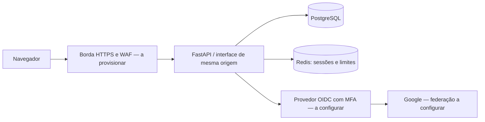

# Arquitetura e decisões

## Contexto e fronteiras

Aplicação web para finanças pessoais, inicialmente BRL e pt-BR. Um usuário só acessa seus próprios lançamentos e metas. Não há conta conjunta, movimentação bancária, custódia ou recomendação de investimentos nesta etapa.

## ADR 001 — Monólito modular

Adotado para reduzir complexidade operacional inicial. `domain.py` contém cálculos e validação; `db.py`, persistência; `security.py`, sessão e controles HTTP; `main.py`, contratos HTTP. Evoluir para módulos de domínio antes de considerar microsserviços. Extração de documentos e agentes terão workers com filas, limites de custo, retentativas e idempotência.

## ADR 002 — PostgreSQL e dinheiro inteiro

Valores inteiros em centavos, nunca ponto flutuante no backend. Restrições no banco complementam validação Pydantic. Datas de lançamento são datas civis; não timestamps. Todas as consultas financeiras incluem `owner`, derivado de issuer/sub autenticados; IDs enviados pelo cliente nunca definem proprietário. Índices por proprietário/data e chave de importação.

Não há RLS nesta entrega. Introduzir papel de aplicação sem privilégios administrativos e RLS como defesa adicional antes da produção. O usuário de banco do Compose serve somente ao desenvolvimento. Mudanças futuras de schema exigem migrações versionadas; a migração inicial é SQL explícito.

## ADR 003 — Identidade externa, sessão interna

OIDC Authorization Code com PKCE S256, state e nonce geridos por Authlib. Tokens não ficam em localStorage nem são retornados ao navegador. Sessão opaca de 256 bits; Redis armazena estado de login, identificador pseudônimo e token CSRF. TTL ocioso de 30 minutos e absoluto de oito horas. Rotação após login, revogação no logout. Nenhuma senha local.

## ADR 004 — IA fora do cálculo financeiro

Saldo, categorias agregadas e metas são determinísticos. Nesta etapa a classificação é um conjunto explícito de palavras-chave; não é um agente de IA. A próxima etapa terá interface de provedores, saída estruturada, versão de prompt/modelo, confiança, evidências e avaliação com corpus anonimizado. Descrições de fatura são dados não confiáveis, nunca instruções para ferramentas. Agentes não poderão comprar, pagar ou alterar metas automaticamente.

## Contratos implementados

| Método | Rota | Função |
|---|---|---|
| GET | `/api/me` | Sessão e token CSRF |
| GET | `/api/dashboard?month=AAAA-MM` | Agregados, lançamentos do mês e metas |
| POST | `/api/transactions` | Criar lançamento |
| PUT / DELETE | `/api/transactions/{id}` | Revisar ou excluir lançamento próprio |
| POST | `/api/import/preview` | Validar CSV sem persistência |
| POST | `/api/import/confirm` | Importar atomicamente os registros válidos |
| POST / PUT | `/api/goals[/{id}]` | Criar ou atualizar meta |
| GET | `/api/privacy/export` | Exportar os dados próprios |
| DELETE | `/api/privacy/data` | Excluir os dados financeiros ativos |
| POST | `/api/logout` | Encerrar sessão local |

## Limites conhecidos

Dashboard e exportação ainda carregam registros na memória; definir paginação, quotas e exportação assíncrona antes de alto volume. Redis usa cliente síncrono; separar chamadas do loop assíncrono antes de escalar. O limite atual é por IP direto; atrás de proxy compartilhado ele é agregado. Implementar identificação de IP exclusivamente a partir de proxies confiáveis e cotas por usuário. Não há orçamento por categoria, recorrência, parcelas ou conciliação de fechamento de fatura.
